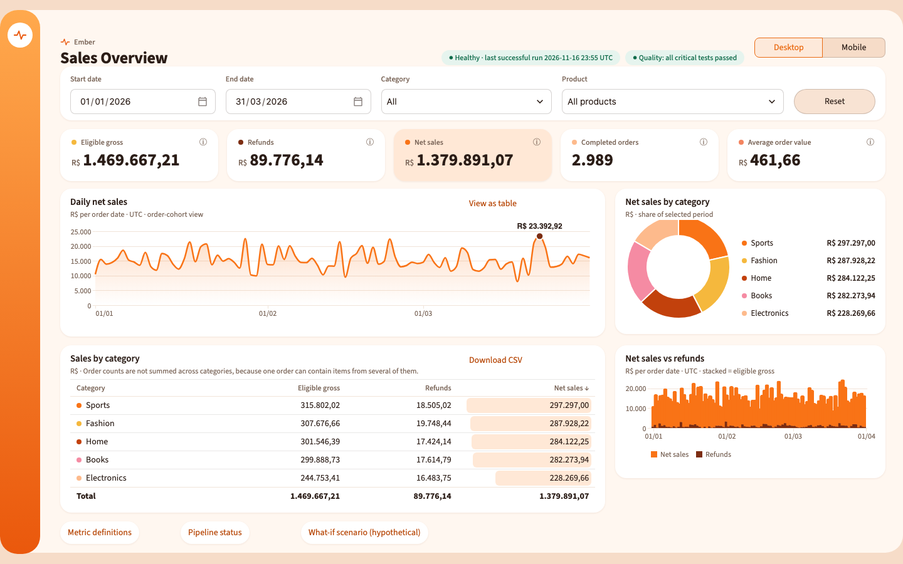
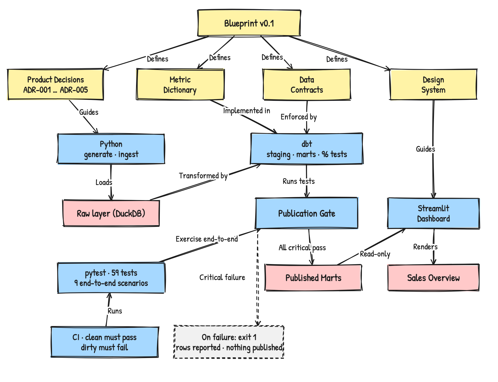
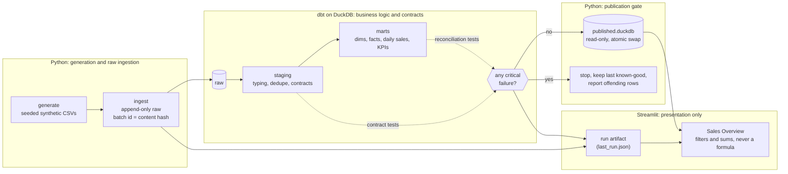
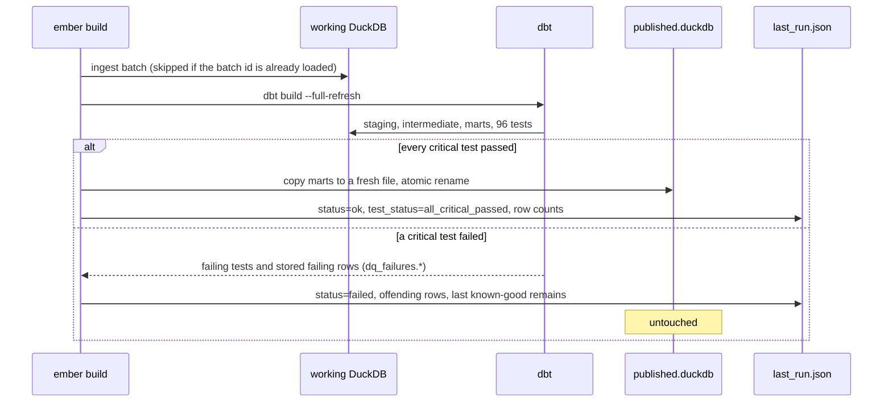
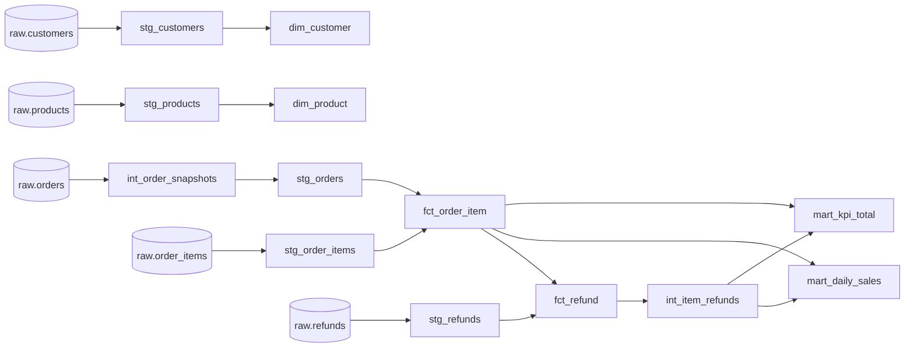
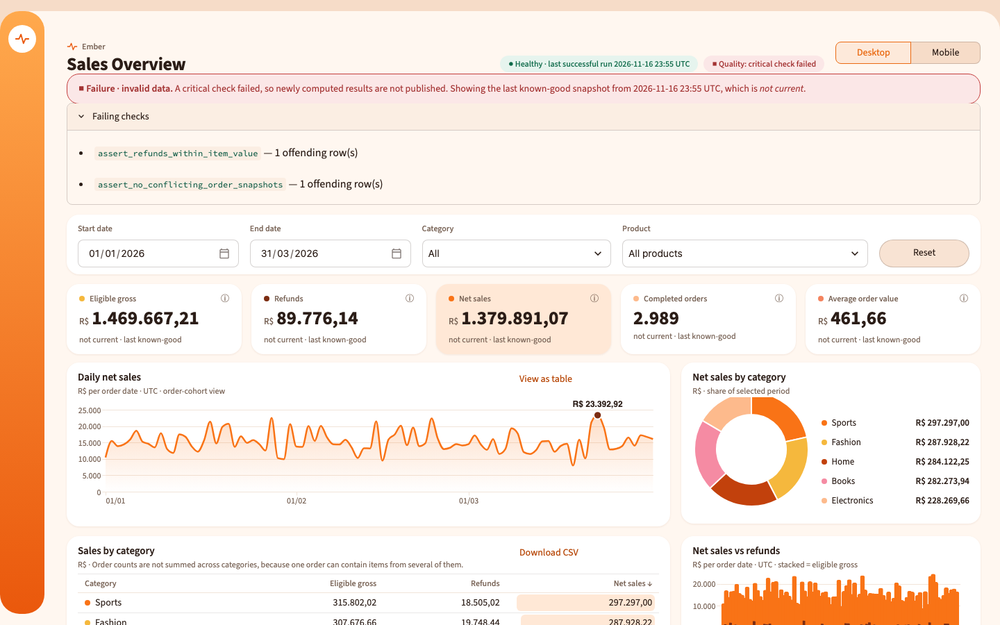
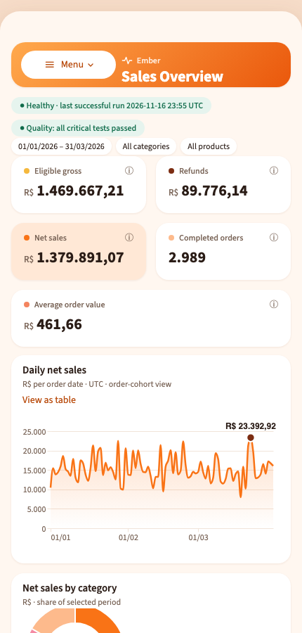
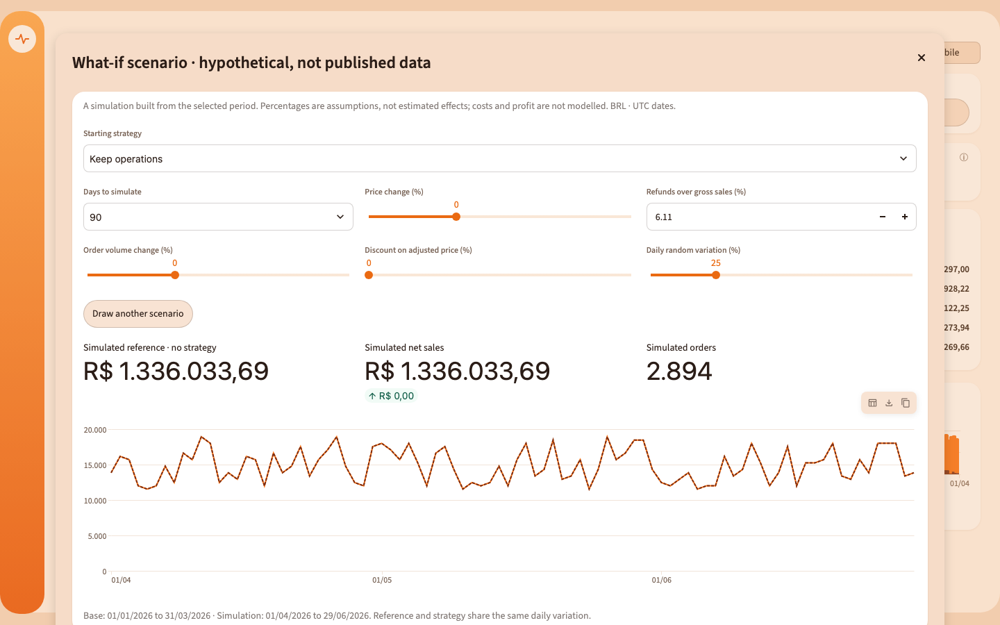

# Ember

**E-commerce Metrics, Business Evaluation & Reporting**

Ember is a small analytics engineering platform. It
takes synthetic e-commerce records through tested transformation models and publishes them to
a dashboard in which every number can be traced back to its definition.

The domain (an e-commerce operation with orders, items, refunds and late status changes) is
fictional. Every rule, threshold and dataset is an assumption. No real customer data exists in
this repository.



| | |
|---|---|
| **Stack** | Python 3.12, DuckDB, dbt Core, Streamlit with Altair, pytest, GitHub Actions, uv |
| **Scope** | 13 dbt models, 96 dbt data tests, 59 Python tests, one dashboard screen, five architecture decision records |
| **Method** | The product decisions, data contracts, metric dictionary and design system were written as a blueprint before implementation. The code was built to satisfy that blueprint. |

## Contents

1. [The problem](#the-problem)
2. [How it was built](#how-it-was-built)
3. [Architecture](#architecture)
4. [Data model and metrics](#data-model-and-metrics)
5. [The quality gate](#the-quality-gate)
6. [The dashboard](#the-dashboard)
7. [Testing](#testing)
8. [Running the project](#running-the-project)
9. [Repository layout](#repository-layout)
10. [Decisions and limitations](#decisions-and-limitations)

## The problem

An e-commerce operation has customer, order, item and refund data, but its teams cannot
compare revenue metrics with confidence, for three reasons:

- Records are duplicated by retries and replays.
- Order statuses change after purchase, and refunds arrive weeks later, sometimes more than
  once for the same item.
- KPI definitions differ between the dashboard and the SQL that analysts run by hand.

Ember addresses this with one rule: a number is shown only if it passed every critical
check, and its definition lives in one place, which the dashboard quotes verbatim.

| Persona | Need | Evidence of success |
|---|---|---|
| Business analyst | Analyze sales by day, product and segment | The same metric value in the dashboard and in SQL |
| Finance | Reconcile gross sales, cancellations and refunds | Every aggregate can be explained at order level |
| Analytics engineer | Rerun and change transformations safely | Deterministic pipeline, automated tests, documented lineage and runbook |

## How it was built

The project started as a seven-page blueprint covering the product brief, architecture, data
contracts, metric dictionary, design system, the single screen and operations. Everything in
the diagram below was derived from it. Yellow boxes are the artifacts the blueprint fixed up
front, blue boxes are the components that do the work, and pink boxes are the outputs.



Delivery was organised in three sprints. Each sprint had a demo that defined when it was done.

### Step 0: decisions

Before any code, the blueprint's recommended options were adopted and recorded:

- Domain: a fictional e-commerce operation.
- Demo: local reproducibility rather than a hosted dashboard.
- Financial semantics: only orders whose latest status is `completed` are eligible; only
  succeeded refunds on eligible items count; reporting uses order-cohort time.

These are recorded as ADR-001 to ADR-005 (see `docs/adr/`). Changing any of the financial
semantics is treated as a breaking change.

### Sprint 1: foundation

Demo: a deterministic rerun, and an invalid record being detected.

| Step | Delivered | Verified by |
|---|---|---|
| 1. Bootstrap | A `uv`-locked environment, the `ember` command-line interface, and a YAML configuration that holds every domain assumption (distributions, share of late updates, refund rates). | `uv sync` followed by `pytest` passes on a clean checkout. |
| 2. Generator | Five CSV sources and a manifest with file hashes. Orders are emitted as snapshots carrying `updated_at`, `source_sequence` and `record_hash`. A "dirty" profile injects six known violations. | The same seed produces byte-identical files. The dirty manifest lists each injected case. |
| 3. Ingestion | A raw layer loaded as delivered (text), stamped with ingestion time, source id and a content-hash batch id. | Re-ingesting an unchanged batch is a no-op; a changed batch is appended. |
| 4. Staging | Typing through `try_cast`, so that a bad value becomes NULL and fails a contract test instead of crashing the load. Newest-batch-per-key for entity tables, snapshot deduplication for orders, and 56 contract tests. | The clean fixture passes all 56 tests. The dirty fixture fails and the offending rows are named. |

### Sprint 2: trusted metrics

Demo: a change in order status updates the metrics without creating duplicates.

| Step | Delivered | Verified by |
|---|---|---|
| 5. Marts | `dim_customer`, `dim_product`, `fct_order_item` (with the latest status and an eligibility flag), `fct_refund` (with a recognition flag), `mart_daily_sales` at date and product grain, and `mart_kpi_total`. | Refunds are aggregated to item grain before any join, so there is no fan-out. |
| 6. Reconciliation | Singular SQL tests: net sales agree across the facts, the daily mart and the KPI total; refunds never exceed item value; orders are counted as orders; average order value is NULL when there are no orders. | 96 dbt tests run on every build. |
| 7. Publication gate | One command runs ingestion, dbt and publication. Marts are copied to a separate read-only DuckDB file by atomic replacement, and only when every critical test passed. | A dirty build exits with code 1, publishes nothing and keeps the last known-good snapshot. |
| 8. Scenarios | The nine cases from the data contract, each running the full pipeline on a throw-away database. | 10 end-to-end tests. |

### Sprint 3: product surface

Demo: a fresh install, a failing build, recovery, and KPI drill-down.

| Step | Delivered | Verified by |
|---|---|---|
| 10. Dashboard | The Sales Overview screen: freshness badge, quality chip, five KPI cards, filters, daily chart and category breakdown, with loading, empty, stale and failure states. | Streamlit `AppTest` renders every state. Unfiltered queries equal `mart_kpi_total`. |
| 11. Continuous integration | Three jobs: lint, unit tests and the clean pipeline; the nine scenarios; and a job in which the dirty fixture must fail. | The workflow mirrors the local commands. It has not yet been executed on GitHub. |
| 12. Documentation | Product, architecture, data contracts, metrics, design system, runbook and ADRs. | Links verified. |
| Visual v2 | Desktop and mobile layouts, category donut and stacked views, and a what-if dialog labelled as hypothetical. | 16 dashboard tests. The what-if dialog never alters published KPIs. |

## Architecture

There are three owners and three boundaries. Python never computes a metric. dbt never reads a
file. Streamlit never touches raw tables.



| Concern | Choice | Reason | Cost |
|---|---|---|---|
| Analytical database | A DuckDB file | Local, fast, free and reproducible in CI | Single writer. Solved by publishing a separate snapshot. |
| Transformations | dbt Core with dbt-duckdb | The contract lives in SQL, with lineage, tests, macros and docs | Adapter versions must be pinned |
| Dashboard | Streamlit with Altair | The fastest path to interactive evidence | Less layout control than a front-end framework |
| Automation | GitHub Actions | A visible quality gate on pull requests | Isolated setup on every run |
| Packaging | `pyproject.toml` with `uv.lock` | A byte-reproducible environment | Dependency maintenance |

### The pipeline as a sequence



## Data model and metrics

### Sources

The sources are synthetic and deliberately messy.

| Table | Grain | Edge cases built in |
|---|---|---|
| `customers` | One row per customer | A missing segment, mapped to `unknown` |
| `products` | One row per product | None |
| `orders` | Snapshots, several rows per order | Status changes after creation, replays, conflicting versions |
| `order_items` | One row per item | Several items per order |
| `refunds` | One row per transaction | Partial refunds, repeated refunds, refunds on non-eligible items, the same refund delivered twice |

### Lineage



### Deterministic deduplication

Orders arrive as snapshots. The rule is applied in this order:

1. Collapse exact replays. Rows with the same `record_hash` are one record.
2. Pick the latest snapshot per order: the maximum `updated_at`, then the maximum
   `source_sequence`.
3. Refuse to guess. If two rows still share the ordering keys but differ in content, the load
   is rejected and the conflicting order is named.

Entity tables keep the rows from the newest batch that delivered each key and then collapse
exact duplicates. A key delivered twice in one batch with different content fails the
uniqueness contract.

### Metric dictionary

The metrics are implemented once, in the marts. The dashboard quotes these definitions and
computes nothing else.

| Metric | Definition | Notes |
|---|---|---|
| `eligible_gross` | Sum of `quantity × unit_price` for items whose latest order status is `completed` | Pending and cancelled orders are excluded |
| `refunded_amount` | Sum of succeeded refunds linked to eligible items | Pending and failed refunds are excluded; capped at item value |
| `net_sales` | `eligible_gross − refunded_amount` | Two decimal places, BRL |
| `completed_orders` | Count of distinct completed `order_id` | Never item rows |
| `average_order_value` | `net_sales / completed_orders` | NULL when there are no orders; never a division error |

Reporting uses order-cohort time: a late refund restates the net sales of the original order
date. History can therefore change, and the dashboard states this.

### Quality policy

| Severity | Examples | Outcome |
|---|---|---|
| Critical | Duplicate keys after deduplication, missing foreign keys, negative amounts, reconciliation mismatch, conflicting snapshots | The build fails, nothing is published, and the offending rows are stored |
| Warning | An unexpected but parseable status, a missing optional segment | Reported; the value is mapped to `unknown` |
| Accepted | Exact replays, a later `updated_at`, valid partial refunds | Deterministic rebuild |

## The quality gate

This is the output of a build on the dirty fixture:

```
[build] status=failed test_status=critical_failure
  ingest : ok batch=8d04e2111cc2
  dbt    : models=7 tests=96 failed=4 warned=0
    ✗ non_negative_stg_order_items_unit_price (1 rows)
        {'order_item_id': 'I99999992', 'order_id': 'O0000001', 'unit_price': '-10.00', …}
    ✗ assert_no_conflicting_order_snapshots (1 rows)
        {'order_id': 'O0000375', 'updated_at': '2026-01-01 02:21:40', 'source_sequence': 2, 'conflicting_versions': 2}
    ✗ assert_refunds_within_item_value (1 rows)
        {'order_item_id': 'I00000001', 'item_amount': '300.95', 'refunded_amount': '902.85'}
  4 critical test(s) failed; nothing published.
```

Only 7 of the 13 models were built, because everything downstream of a failing test is
skipped. The process exited with code 1 and the published file was not written. Pointed at
that run, the dashboard reports the failure and shows the previous snapshot, labelled as not
current:



CI encodes the same expectation: the clean pipeline must pass, the nine scenarios must pass,
and the dirty fixture must fail without publishing anything.

## The dashboard

There is one screen, Sales Overview. It reads only the published snapshot and the run
artifact. Its data layer may filter and sum the marts at their declared grain and nothing
else. A test asserts that its unfiltered queries equal `mart_kpi_total` to the cent.

| Desktop | Mobile |
|---|---|
|  |  |

The screen provides:

- A freshness badge based on the last successful pipeline run, not on page load. It changes
  to "Stale" after 24 hours.
- A quality chip (pass, warning or failure) expressed in words and shape, never by colour
  alone.
- Five KPI cards whose tooltips quote the metric dictionary verbatim.
- Filters by date range, category and product. The options come from `dim_product`; nothing
  is hard-coded.
- Daily net sales (order-cohort, UTC, y-axis starting at zero, formatted as `R$ 1.234,56`),
  net sales by category, net sales against refunds, and a category table with totals. A note
  explains that order counts are not additive across categories.
- Four states: loading; no completed orders for the current filters (never a misleading
  `R$ 0,00`); stale; and critical failure with the last known-good snapshot.
- A mobile view (`?view=mobile`) with a fixed header and a menu for filters, definitions,
  pipeline status and the what-if dialog, with the same cards stacked.

A what-if dialog lets the viewer explore hypothetical volume, price, discount and refund
assumptions over the selected period. It is labelled as hypothetical, uses a seeded toy
model, and a test confirms that it never alters the published KPIs.



The design system (Pulse UI, in `docs/design-system.md` and in the blueprint) and the
dashboard share one palette: a warm neutral ground, one orange primary and three status
hues. Design tokens live in a single stylesheet, `dashboard/tokens.css`.

## Testing

Each layer is tested where a defect would appear.

| Layer | Tests | What is checked |
|---|---|---|
| Generator | 14 | Determinism by seed, key integrity, presence of every injected violation |
| Ingestion | 5 | Metadata columns, no-op replay, append of a changed batch, run artifact |
| End-to-end scenarios | 10 | The nine data-contract cases, each running ingestion, dbt and publication |
| Dashboard | 16 | The data layer equals the marts; every screen state renders |
| What-if model and tables | 14 | Determinism by seed, input bounds, pagination and sorting |
| dbt | 96 | 91 schema tests and 5 reconciliation tests on every build |

The nine scenarios, taken from the data contract:

| # | Scenario | Expected result |
|---|---|---|
| 1 | Duplicated input batch | The same counts and sums after replay |
| 2 | Late update from `completed` to `cancelled` | The order's contribution disappears on reprocessing |
| 3 | One order with three items | The order count stays 1 |
| 4 | One item with two partial refunds | Gross counted once, both refunds counted |
| 5 | Refund greater than item value | The gate fails and nothing is published |
| 6 | Missing customer reference | The gate fails |
| 7 | Zero completed orders | Average order value is NULL, not a division error |
| 8 | Late refund | Net sales of the original order date are restated |
| 9 | Two conflicting snapshots with identical keys | The load is rejected explicitly |

## Running the project

The only prerequisite is [`uv`](https://docs.astral.sh/uv/). It installs Python 3.12 and
every pinned dependency.

```bash
uv sync                                                # pinned environment
uv run ember generate --profile demo                   # 90 days of deterministic synthetic data
uv run ember build --src data/generated/demo --fresh   # ingest, dbt build, publish
uv run streamlit run dashboard/app.py                  # http://localhost:8501
```

To see the gate refuse a broken batch:

```bash
uv run ember generate --profile dirty
uv run ember build --src data/generated/dirty --db data/dirty.duckdb --published data/dirty_published.duckdb --fresh
```

To run what CI runs:

```bash
uv run ruff check . && uv run ruff format --check .
uv run pytest                                          # 59 tests, about 35 seconds
```

Fixture profiles: `clean` (600 orders over 14 days), `tiny` (used by CI), `demo` (4,000
orders over 90 days) and `dirty` (the clean profile plus six injected violations). The full
command reference and troubleshooting guide are in the [runbook](docs/runbook.md).

## Repository layout

```
.
├── config/          Generator assumptions (seed, dates, distributions) and fixture profiles
├── ember/           The command-line interface: generate, ingest, build
├── analytics/       The dbt project: sources, staging, intermediate, marts, macros, tests
├── dashboard/       The Streamlit app, its read-only data layer, formatting, what-if model and tokens
├── tests/           Unit tests, dashboard tests, and the end-to-end scenarios
├── .github/         CI workflow
├── data/            Generated fixtures, DuckDB files and the run artifact (ignored by git)
└── docs/
    ├── product.md, architecture.md, data-contracts.md, metrics.md
    ├── design-system.md, runbook.md
    ├── adr/         ADR-001 to ADR-005
    ├── blueprint/   The original v0.1 blueprint
    └── images/      Screenshots and diagrams
```

## Decisions and limitations

### Architecture decision records

| ADR | Decision | Accepted consequence |
|---|---|---|
| 001 | DuckDB locally, no cloud warehouse | A single-writer file, which is why a separate read-only snapshot is published |
| 002 | dbt owns every formula; the dashboard only filters and sums | A new KPI starts as a dbt model with tests, then reaches the UI |
| 003 | Order-cohort time; late refunds restate history | Past days can change, and the UI must say so |
| 004 | Full refresh first; incremental only when tests prove replay safety | Slower builds in exchange for straightforward idempotency |
| 005 | Critical failures block publication | One bad row blocks everything, so error messages must name the row |

### Known limitations

- Single currency (BRL), with no taxes, shipping, discounts or chargebacks. `eligible_gross`
  is eligible merchandise sales, not revenue under an accounting standard.
- Order-cohort view only. There is no refund-cashflow view by refund date.
- Full-refresh materialization only, by design.
- No authentication, hosting or multi-user serving, and nothing real-time.
- The what-if simulator is a simple model with uniform daily noise and no seasonality or
  price elasticity. Its purpose is to show hypothetical and published numbers coexisting
  without being mixed.
- The CI workflow mirrors the local commands but has not yet been executed on GitHub.

### Engineering highlights

- Writing the contract before the code. Metrics, source contracts and the nine scenarios
  were fixed in the blueprint, and the implementation had to satisfy them.
- Determinism as a requirement: seeded generation, content-addressed batches and hash-based
  replay collapse, so that running the pipeline twice is a test.
- dbt beyond basic models: snapshot deduplication with `qualify`, typing macros that turn bad
  values into test failures instead of crashes, generic and singular tests with severities,
  stored failures, and aggregating to grain before joining to avoid fan-out.
- A publication gate with atomic replacement and last-known-good semantics, so nothing
  reaches the reader unless the tests passed.
- Dashboards that report freshness from the pipeline rather than the page, show empty states
  instead of zeros, express status in words and shape, and quote definitions rather than
  paraphrasing them.
- Testing the whole system: Streamlit's `AppTest` for every screen state, and dbt running
  in-process on throw-away databases for the end-to-end scenarios.

Status by step and open items are tracked in [ROADMAP.md](ROADMAP.md).
